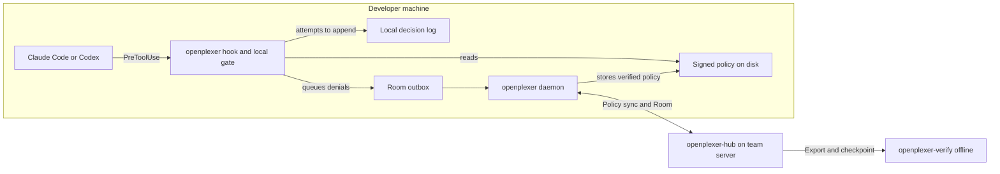

# Architecture and privacy

OpenPlexer can check a coding agent's actions with a signed policy on disk. A team can also run a hub to distribute policy, share Room events, and export a team audit log. The [trust model](trust-model.md) explains the assumptions behind both setups.

## Where the parts run

- **Local gate.** The coding agent runs `openplexer hook` before a matched tool call. The adapter turns the input into policy queries. The hook opens and verifies the local policy and attempts to record decisions that reach the gate. If the audit append fails, the hook preserves a policy denial and blocks an otherwise allowed call. The gate can use a signed bundle from disk and a trusted local key set without a hub. [Local policy gate](local-policy.md).
- **Hub and signed policy.** `openplexer-hub` serves one team. Each project names one repository and has a Room with the same ID. The hub signs the policy bundle with its ES256 key. On sync, `openplexer` checks the bundle against both the hub's advertised keys and the public keys pinned locally. Load and sync reject versions below the project's floor and different content at the floor version. The floor survives key and config changes and removal of the stored policy. [Hub setup](hub.md), [team enrollment](local-policy.md#connect-to-a-team-hub), and [the version checks](local-policy.md#what-a-load-accepts).
- **Room.** The Room is a sequence of events for a project. The hub serves replay and live updates and provides an API for claim leases. `openplexer daemon` resumes the stream from its saved position and writes received events as JSON lines to standard output. The daemon also delivers queued posts. The local hook reads policy directly from disk. [Room HTTP API](hub.md#http-api).
- **Team audit log and verifier.** The hub writes its own hash chain and signs a checkpoint at export with a separate ES256 key. `openplexer-verify` reads the JSON export, a checkpoint key set, and any supplied checkpoints from files. It runs offline on any review machine. [Export and verify an audit log](audit.md).

## What each setup guarantees

| Holds locally with no hub | Depends on the hub | Not provided |
|---|---|---|
| Installed hooks can deny policy violations before a covered tool runs. Claude Code covers `Write`, `Edit`, `NotebookEdit`, and `Bash`. Codex covers `Bash` and `apply_patch`. [Hook coverage](trust-model.md#hook-coverage-differs-for-each-coding-agent). | | Read restrictions, a separate `git.push` check, and coverage of unmatched tools or outside processes. The shell check can miss write targets. There is no check after a command runs. [Actions outside the hooks](trust-model.md#actions-outside-the-hooks-are-not-seen) and [shell write checks](trust-model.md#shell-write-checks). |
| A hook denies calls it judges when it has no verified policy. The Claude Code entry blocks on hook failure. [When a hook fails](trust-model.md#when-a-hook-fails). | | An operating-system security boundary. A same-user process can disable the hook or change its state. Codex may run a tool if its hook cannot start or is killed. [Same-user limits](trust-model.md#the-same-os-user-can-undo-all-of-it) and [hook failures](trust-model.md#when-a-hook-fails). |
| The gate checks the local pin each time it opens. An unreachable hub leaves the last verified policy in force. [Local pin](trust-model.md#signature-and-key-distribution) and [offline enforcement](trust-model.md#offline-the-daemon-keeps-enforcing-the-last-verified-bundle). | An operator with the pinned private key can sign new policy. The hub distributes policy and authenticates team requests. [Hub operator and keys](trust-model.md#decisions-settled-by-the-single-team-hub). | Automatic policy expiry or an immediate local cutoff when a token is revoked. The hub cannot replace a client's pin over the protocol. [Policy freshness](trust-model.md#a-stale-policy-has-no-expiry-today) and [revocation](trust-model.md#decisions-settled-by-the-hub-connection). |
| The local gate can run without Room access. | The hub orders Room events, assigns authors from member tokens, and serves events to team members. [Room delivery](trust-model.md#decisions-settled-by-the-hub-connection). | A private Room within the team, claim-based enforcement, or hook injection of Room text into the agent. [Hub access](trust-model.md#decisions-settled-by-the-single-team-hub) and [Room delivery](trust-model.md#decisions-settled-by-the-hub-connection). |
| Room post filtering runs on the developer's machine. [Content filters](trust-model.md#free-text-filtering-is-a-heuristic). | The hub stores accepted events. The operator can read them. [Hub storage](trust-model.md#decisions-settled-by-the-single-team-hub). | A guarantee that prose is free of secrets or source code. Direct API callers bypass the local filters, and the hub validates event shape without filtering the content. [Content filters](trust-model.md#free-text-filtering-is-a-heuristic). |
| Policy decision records stay on the machine. The standalone verifier can check a supplied export for chain consistency. [Local records](trust-model.md#what-openplexer-sends) and [chain-only verification](trust-model.md#what-a-verifier-can-prove-from-a-chain-alone). | The hub writes and exports the team chain and signs checkpoints. A trusted checkpoint anchors the chain through its record count. [Trusted checkpoints](trust-model.md#how-a-verifier-obtains-a-trusted-checkpoint). | Without a trusted checkpoint, a truncated tail or a full rewrite with recomputed hashes can pass. Even with one, the verifier cannot prove that every action was recorded, that records are true, or that the timestamps are independent. [Chain-only verification](trust-model.md#what-a-verifier-can-prove-from-a-chain-alone) and [trusted checkpoints](trust-model.md#how-a-verifier-obtains-a-trusted-checkpoint). |

The hub operator can manage membership, read and change hub state, withhold updates, and sign policy or a new checkpoint. The hub API gives the operator no access to files on the developer's machine. A checkpoint and trusted public keys kept outside the hub let a reviewer check a later export against history the hub signed earlier. Records after the latest supplied checkpoint still have no external anchor. [Hub operator and keys](trust-model.md#decisions-settled-by-the-single-team-hub) and [trusted checkpoints](trust-model.md#how-a-verifier-obtains-a-trusted-checkpoint).

## What leaves the developer's machine

The local hook and a policy loaded from a file need no network. When you configure a hub, the client sends the requests below to that origin. It requires HTTPS except on loopback and refuses redirects. [Hub connection](trust-model.md#decisions-settled-by-the-hub-connection).

| When | Request | Data sent |
|---|---|---|
| On `policy sync`, on daemon startup, and every 15 seconds while the daemon runs | `GET /api/v1/projects/{project}/policy.bundle` | The project ID in the route and the member bearer token in the authorization header. No request body. |
| During each sync that gets a policy response with a signed token | `GET /.well-known/jwks.json` | A request for the public policy JSON Web Key Set (JWKS). No bearer token or request body. The advertised keys do not replace the local pin. |
| When the daemon connects or reconnects to the Room stream | `GET /api/v1/rooms/{room}/stream?last_seq=N` | The Room ID, member bearer token, and last saved sequence number in the `last_seq` query parameter. The cursor starts at zero. There is no request body. |
| When the running daemon flushes the outbox, which it checks on a one-second timer | `POST /api/v1/rooms/{room}/events` | The Room ID, member bearer token, and an `Idempotency-Key` made from the local queue time and a random suffix. The JSON contains `type`, `body`, and, for an agent post, `agent.id`, `agent.vendor`, and optional `agent.parent`. Retries use the same key. |

After a hub `behind` error, the daemon opens a new GET stream from its saved cursor. A valid event with a higher sequence advances the cursor even across a gap. A sequence gap alone triggers no resume.

### Room post fields

`openplexer room post` reads JSON from standard input and queues only the fields below. Posts may also have `thread_id` and `reply_to` in the body. `human` has no client-supplied `agent` field. The daemon discards extra fields and rejects recognized secret or code patterns in prose. It checks identifiers and filters path fields. It applies the filter again before sending. The hub assigns its own event ID, sequence, timestamp, and author.

| Type | Body fields the daemon can send |
|---|---|
| `status` | `summary`, `plan_step`, `files` containing filtered relative paths |
| `decision` | `title`, `detail`, `scope`, `supersedes` |
| `question` | `text`, `addressed_to`, `ack_required` |
| `answer` | `question_id`, `text` |
| `blocked` | `reason`, `needs.decision`, `needs.request_id` |
| `human` | `text`, `mentions` |
| `policy.denied` | For a hook-generated denial, `action`, `path`, and `rule` set to `denied by policy` |

A hub-configured hook can queue `policy.denied` when a verified policy denies a call and the hook has a valid session ID. It includes that ID and the adapter name. The adapter converts a write target inside a recognized project to a project-relative path before the policy check, even if the tool input names an absolute path. The Room can receive that relative path if it passes the filter. The filter sets `path` to `[omitted]` for `exec` and `git.push` and for any resulting policy target that is still absolute or otherwise unsafe. The event carries no command text, detailed rule, or area. A refusal before policy evaluation, such as an unreadable tool call or missing policy, does not generate this post. [Denial reporting](trust-model.md#decisions-settled-by-the-hub-connection).

The daemon makes no claim API calls. A member who creates a claim through the hub API sends an agent identity, an item, paths, and intent. The request can include a claim mode, duration, and the `implicit` flag. Renewals and releases send a claim ID and a session ID, plus a new duration or an optional release outcome. The daemon's content filter does not run for direct HTTP requests. The hub validates events, but direct posts can contain prose and extra body fields that the daemon would have rejected or dropped. [Hub HTTP API](hub.md#http-api) and [content filters](trust-model.md#free-text-filtering-is-a-heuristic).

### Audit records and excluded data

Local policy loads and evaluations can write to `audit.jsonl`. Those records can include member and session IDs, paths, policy reasons, and the SHA-256 of a checked command. The daemon never uploads this log. The hub builds its own records when members are added or removed, a project is added, a policy changes, or the hub accepts a new denial event. The denial audit record holds the member and session IDs and a reference to the Room event. Its body and detailed local verdict stay out of the team audit record. [Local audit log](local-policy.md#the-audit-log) and [hub audit log](hub.md#export-the-audit-log).

The operator can export team records on the hub host. A lead can also send a lead bearer token to `GET /api/v1/audit/export`. The hub returns the records and a signed checkpoint. The public checkpoint keys are at `GET /.well-known/audit-jwks.json`, separate from the policy keys. The verifier reads files supplied by the reviewer. [Export and verify an audit log](audit.md#export-from-the-hub).

OpenPlexer has no separate telemetry or analytics service. The daemon sends no presence reports, read receipts, injection counters, write ledger, file hashes, raw tool input or output, patches, diffs, or file contents. Room prose is user or agent supplied. It can still contain source or secrets that the filter misses. Keep sensitive material out of Room posts. [Outbound data](trust-model.md#what-openplexer-sends) and [content filters](trust-model.md#free-text-filtering-is-a-heuristic).

### Member sync state

> The hub keeps the time and version of the last policy it served and the time of the last live Room connection it accepted for each member and project. Team leads and operators with access to the hub's data can see these values. They show hub activity and cannot confirm that a laptop applied policy or is still online. OpenPlexer stores no laptop identifiers, IP addresses, or per-request history in member sync state. Each value expires after 30 days. Removing a member clears that member's sync state.

## What the hub stores and for how long

The Go hub keeps its main snapshot in the owner-only `state.json`. The snapshot includes the team ID, member IDs and roles, SHA-256 hashes of bearer tokens, project and repository IDs, the latest signed bundle per project, and the policy and checkpoint signing keys. Removing a member deletes that member's token hash from the active roster. It leaves earlier Room and audit records in place. A new policy replaces the prior bundle for its project.

Room history includes accepted event bodies, session and member IDs, event metadata, and any posted idempotency keys. The hub keeps Room history and the team audit chain indefinitely. It has no automatic pruning, redaction, or deletion schedule. Released claims leave active storage. Expired claims are removed on the next authenticated claim operation in an existing Room. Their events remain in Room history. Backups may keep copies of any of this state. [Hub storage](trust-model.md#decisions-settled-by-the-single-team-hub) and [backup procedure](self-host.md#back-up-and-upgrade).

## What this repository includes

OpenPlexer is the Apache-2.0 open-source foundation. This repository contains the local gate and adapters, Room protocol, single-team self-hosted hub, and audit log and verifier. [README](../README.md) and [roadmap](roadmap.md).

The TypeScript reference includes features outside this repository's scope. This repository does not include the web dashboard, terminal UI, sign-up, invitations, multi-team workspaces, notifications, metrics, attention features, history search, configurable retention, the GitHub App and server check, or the write ledger. Hosted or commercial capabilities are outside this repository. [Provenance and scope](provenance.md#what-stays-outside-this-repository).
