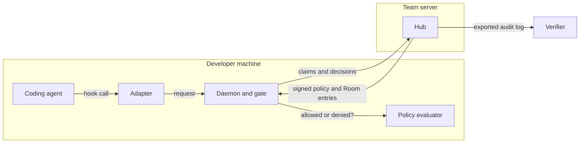

# Architecture

> [!NOTE]
> This page describes the design. The directory structure and the dependency rules exist today. Of the behavior, the policy evaluator and the gate exist, and the gate has no adapter and no hub yet ([Local policy gate](local-policy.md)).

This page explains how the parts of OpenPlexer connect, and why the code is split the way it is. [Concepts](concepts.md) defines the terms. [Repository layout](repository-layout.md) lists every directory.

## How the parts connect

One action passes through the system in these steps.

1. A coding agent is about to act. Its hook calls the adapter for that agent.
2. The adapter turns the hook call into a request and passes the request to the gate in the daemon.
3. The gate asks the policy evaluator for a result. The evaluator returns allow, or deny with a reason.
4. The coding agent continues, or it receives the reason for the denial.

The daemon also connects the developer's machine to the hub. The daemon sends claims and decisions to the Room, and it receives signed policy and the Room entries of other agents.

The hub appends records to the audit log and exports the log. The verifier checks an exported log on any machine.

## Three binaries for three different people

Each binary runs in a different place and is trusted by a different person.

| Binary | Runs on | Who has to trust it |
|---|---|---|
| `openplexer` | A developer's machine | The developer, because it sits next to their code |
| `openplexer-hub` | A server that the team runs | The team lead who operates it |
| `openplexer-verify` | Any machine | Anyone who checks an audit log |

One binary with subcommands would be less code to ship. The design uses three binaries because of what each person should have to install. A developer should not install a server. A person who checks an audit log should not install the system that wrote the log.

## One package per domain

The code under `internal/` is split by what it is about, not by technical layer. `internal/policy` holds everything about policy. `internal/room` holds everything about the Room protocol. `internal/audit` holds everything about the audit chain.

These three packages are the core. They hold the rules of the system and they do not depend on where the rules run. The other packages put the core to work: the adapters connect the core to a coding agent, the daemon runs the core on a developer's machine, and the hub runs the core on a server.

## The dependency rules, and what each one protects

A test in `internal/layering` reads the imports of every package and fails when a package depends on a package that it must not. [Repository layout](repository-layout.md#dependency-rules) has the full table. Each rule protects one property.

**The core does not import the adapters, the daemon, or the hub.** The policy evaluator, the Room protocol, and the audit chain stay free of files, networks, and coding agents. One set of fixtures can then test them, and the same fixtures can test an implementation in another language.

**An adapter does not import the daemon or the hub.** An adapter only translates between one coding agent and the core. A new adapter cannot change how the gate behaves.

**The daemon and the hub do not import each other.** They run on different machines and they agree only through the contracts in `spec/`. The rule also keeps server code out of the binary that a developer installs.

**The verifier imports only `internal/audit`.** The rule is an allowlist. A new internal package is denied to the verifier until someone adds the package to the allowlist. A reviewer can then read all the code that decides whether a log is valid.

Nothing checks a rule that is written only in a document. These rules are in a test, so a change that breaks a rule fails in CI.

## Why everything starts in `internal/`

Go does not let code outside this module import a package under `internal/`. No outside project can depend on these packages, so the packages can change shape freely while the design settles.

A package moves out of `internal/` when an outside importer needs it, and not before. A public package is a promise to keep its API stable, and the project cannot make that promise before the Go code that implements the contracts exists.

## Why the contracts live in `spec/`

The formats are meant to outlive this implementation. A Room event or an audit record that is defined only by Go types can be implemented only by reading Go. The contracts in [`spec/`](../spec/README.md) define each format with a README of rules, and the schemas, examples, and fixtures that apply to it, so the Go code is one implementation of the contract and not the definition of it.

## What is not decided yet

The diagram shows which parts exchange data. It does not show how. The contracts in [`spec/`](../spec/README.md) define the fields of a policy bundle, of a Room event, of the envelope that carries a Room event, and of an audit record. Each contract README lists the questions that are still open for that contract. The transport between the daemon and the hub, the fields of every other message between them, and the storage that the hub uses are open. The implementation phases of the [roadmap](roadmap.md) follow the contracts.
