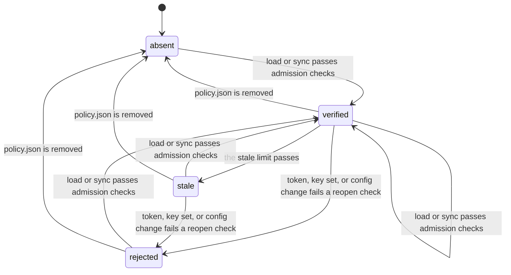

# Local policy gate

The local gate decides actions from the last verified policy on disk. You can load a signed file or run the daemon to sync policy from a team hub. The [trust model](trust-model.md) explains what the gate does not protect against.

`openplexer install` connects a coding agent to the gate, and the hook that it writes runs `openplexer hook`. [Claude Code hooks](hooks-claude-code.md) and [Codex hooks](hooks-codex.md) describe both. `openplexer policy check` asks the gate about one action by hand.

## Connect to a team hub

The daemon in this release requires a hub that serves `GET /api/v1/rooms/{room}/stream` to receive Room events. Upgrade the hub before upgrading the daemon.

Install `openplexer` on `PATH`. Get the hub URL, project ID, member ID, bearer token, and trusted public key set from the hub operator. Save the token in a private file. Export `OPENPLEXER_HOME` with a separate directory for each project. Use the same value for setup, the agent that runs the hooks, and the daemon. [Install OpenPlexer](install.md)

```sh
openplexer configure --hub https://hub.example.com --project prj-shop --member mem-ana \
  --keys trusted-jwks.json --token-file member-token
openplexer policy sync
openplexer daemon
```

`policy sync` fetches the first policy immediately. `daemon` syncs on startup and every 15 seconds. It writes received Room events as JSON lines to standard output and connection errors to standard error. Run one daemon per home. The hooks check the age of the local policy for each covered call.

The daemon verifies the bundle against both the advertised JWKS and the operator-provided pin. Replace the pin explicitly with `configure --keys <jwks.json>` after you confirm the new keys with the operator. To renew a member token, run `configure --token-file <file>`. Use the same member ID as the token's owner.

Queue a Room post by passing a hub event request on standard input. See the [hub HTTP API](hub.md#http-api) for the request fields.

```sh
openplexer room post <<'JSON'
{"type":"status","agent":{"id":"session-1","vendor":"codex"},"body":{"summary":"Ready for review"}}
JSON
```

The daemon retries queued posts after disconnect. Room output resumes after the last saved sequence number. A process crash between writing an event to standard output and saving its sequence can replay that event. Consumers that save Room events can use their event IDs to deduplicate them.

## Load a signed file

You need two files from the person who signs the policy of your team: the signed bundle, and the key set that verifies it. The examples under `spec/policy/v1/examples/` are a bundle and a key set that you can try.

1. Build the binary.

	```sh
	make build
	```

2. Store the key set and your member id. The member id is your id in the `members` of the bundle.

	```sh
	bin/openplexer configure --keys spec/policy/v1/examples/jwks/hub-keys.json --member mem-ana
	```

3. Load the signed bundle.

	```sh
	bin/openplexer policy load spec/policy/v1/examples/signed-bundle/message.json
	```

	The command prints the state `verified`, and your role in the policy.

4. Check an action.

	```sh
	bin/openplexer policy check --repo api write src/orders/cart.ts
	```

	The command prints `allow` or `deny`, and the rule that decided.

## Commands

| Command | Action |
|---|---|
| `openplexer configure --keys <jwks.json>` | Stores the key set that verifies a bundle. The file is a JSON Web Key Set, as `spec/policy/v1/jwks.schema.json` defines. |
| `openplexer configure --member <member-id>` | Stores the member id of the developer. |
| `openplexer configure --stale-after-days <days>` | Sets the advisory age of a local-only policy. The default is 14 days. |
| `openplexer configure --max-policy-age <duration>` | Sets the maximum age of a hub policy. Accepts 1 minute through 1 hour in whole seconds. The default is 5 minutes. |
| `openplexer policy load <signed-bundle.json>` | Verifies a signed bundle and makes it the policy in force. The file is a message, as `spec/policy/v1/signed-bundle.schema.json` defines. |
| `openplexer policy sync` | Fetches and verifies the current hub policy once. |
| `openplexer daemon` | Runs policy sync and the Room client in the foreground. |
| `openplexer room post` | Validates and queues one JSON event request from standard input. |
| `openplexer policy status` | Prints local policy state, including the hub confirmation, age limit, and daemon heartbeat for a hub-connected home. |
| `openplexer policy check-session` | Checks policy at startup. Tries one bounded sync if the hub policy is stale. |
| `openplexer policy check [--agent <name>] [--session <id>] [--repo <repo>] <action> <target>` | Decides one action and prints the result. The action is `read`, `write`, `exec`, or `git.push`. The target is a path for `read` and `write`, a command for `exec`, and a repo for `git.push`. |

One `configure` command can take several of its options.

| Exit status | Meaning |
|---|---|
| 0 | The command succeeded. For `status`, the policy is verified. For `check`, the action is allowed. |
| 1 | The command failed. For `load`, the bundle is rejected or the file cannot be read, and the policy in force is unchanged. |
| 2 | The command line is not valid. The command prints its usage. |
| 3 | `status` and `check-session` report a stale policy. |
| 4 | `status`, `check-session`, and `check` report an unavailable policy. The state is absent or rejected. |
| 5 | `check` only: the action is denied. |

## The home directory

The gate keeps its files in the directory that `OPENPLEXER_HOME` names, or in `.openplexer` in your home directory. The gate creates the directory with access for your user only.

| File | Content | Written by |
|---|---|---|
| `keys.json` | The key set | `configure --keys` |
| `config.json` | Local member and stale settings. A hub configuration also holds its URL, project, bearer token, and optional `max_policy_age_seconds`. Created with mode `0600`. | `configure` |
| `room-cursor.json` | Highest Room sequence received, including skipped event types | `daemon` |
| `room-outbox/` | Filtered posts waiting for acknowledgement, with one idempotency key per file | `room post`, hooks, and `daemon` |
| `room.lock` | Exclusive lock for the daemon that owns the Room cursor | `daemon` |
| `policy.json` | The signed policy and its local load time `confirmed_at`. An authenticated sync also records `hub_confirmed_at` and its binding to the hub and pinned trust settings. | `policy load` and hub sync |
| `policy-floor.json` | The highest admitted version and SHA-256 hash of its canonical bundle JSON, keyed by project ID | `policy load` and hub sync |
| `audit.jsonl` | The audit log, one record on each line | `policy load` and `policy check` |
| `installs/` | The install journal, one record for each hook file: the agent, the file, the project root of a project-scope install, and what `install` added ([The project root](hooks-claude-code.md#the-project-root)) | `install` and `uninstall` |
| `lock` | An empty file that the commands lock while they write | Every command that writes |

When `policy load` or `policy sync` admits a token, the gate checks its size, verifies its signature against `keys.json`, and validates the bundle. With a hub configured, the bundle must match the configured project ID and name exactly one repository. The gate then checks the project's version floor and any policy in force. [What a load accepts](#what-a-load-accepts)

The gate stores the signed token in `policy.json`. On reopen it checks the same size limits, verifies the signature against the current `keys.json`, and validates the bundle and any configured project and repository requirements. If a stored token fails these checks, the gate enforces no policy. Reopen uses the version in the stored token without a version comparison. A program running as you can roll back the policy by writing an older token that passes the reopen checks. The hook denies agent writes into the OpenPlexer home. [Issue 15](https://github.com/Multiplexer-si/OpenPlexer/issues/15) · [What a same-user attacker can still do](trust-model.md#what-a-same-user-attacker-can-still-do-with-the-policy)

The gate limits the compact JWS token to 2 MiB and the raw payload to 1 MiB before signature verification or payload decoding. It derives the decoded length from the base64url payload segment, or uses the segment's byte length for an unencoded JWS. It checks the exact raw length again before UTF-8 conversion. When publishing a policy, the hub limits the submitted JSON bytes and the canonical JSON bytes it signs to 1 MiB each.

## The states of a policy

| State | Meaning | What the gate does |
|---|---|---|
| `absent` | No policy is stored. | It reports that no policy is in force. Future loads still use the version floor. |
| `verified` | The stored policy passes its reopen checks. Its confirmation is within the age limit. | It decides each action. |
| `stale` | The stored policy passes its reopen checks, but its confirmation is missing or outside the age limit. | It denies covered actions if the hub policy stays stale. A local-only policy still decides actions. |
| `rejected` | The stored policy failed a reopen check. | It reports the reason and makes no decision. Future loads still use the version floor. |

The gate computes the state from `policy.json`, `keys.json`, `config.json`, and the clock each time it opens the policy.



A refused load or sync leaves the stored policy as it was.

With no verified policy, the gate does not answer allow or deny. It answers that no policy is in force, and the command that calls the gate chooses what the coding agent may do. The hook denies every call that it judges, with a reason ([the trust model](trust-model.md#decisions-settled-by-install-and-the-hook-command)).

## What a load accepts

`policy load` and `policy sync` check the version floor for the incoming bundle's project. The floor applies in every state. A policy in force also sets a minimum version and requires matching content at that version. [Signed bundle verification](../spec/policy/README.md#the-signed-bundle)

| Bundle | Result |
|---|---|
| A version above the floor and any version in force | Accepted. It becomes the policy in force and raises the project's floor. |
| A version that matches the floor, with the same canonical content | Accepted if it also passes the checks against any policy in force. It can carry a new signature. An authenticated sync refreshes hub confirmation. |
| A version below the floor | Refused, even when the state is absent or rejected. |
| A version that matches the floor, with different content | Refused, even when the state is absent or rejected. |
| A bundle for another project | A hub home requires its configured project. A file-based home can switch projects when no policy is in force. The incoming project's floor still applies. |
| An unreadable or malformed floor | Refused. Duplicate keys and incorrectly cased field names are invalid. The audit log records the reason. |

The floor stores one version and hash per project because every older version is already refused. The gate saves the floor before replacing `policy.json`. Both writes use the home lock and replace each file atomically. If the policy write fails after the floor is saved, retry with the same bundle or a higher version.

For an existing home without a floor file, the first load or sync that verifies an eligible bundle seeds the floor from the stored token's `project_id`, `version`, and canonical content hash. If the stored policy is rejected, the gate reads the payload under the same size and parsing rules as a load, without trusting its signature. That seed can only narrow which verified bundles the gate admits. If the rejected policy cannot be parsed and hashed, the floor starts empty. The gate saves a seeded floor even if the version checks then refuse the incoming bundle. Opening the home stays read-only.

`openplexer configure` preserves the floor, including when you change the key set. Removing `policy.json` alone also preserves the floor. To reset all project floors, stop any commands writing to the home and remove `policy-floor.json` by hand. To load an older version, also remove any stored policy that would block the load or seed the floor again.

## Offline and stale

Hub policy age needs a build newer than `v0.1.0-rc.1`. The private home config stores `max_policy_age_seconds`. Existing hub homes default to 300 seconds. For a two-minute limit, run `openplexer configure --max-policy-age 2m`.

The gate measures hub policy age on the local wall clock. A successful authenticated sync stores the local time at the start of the fetch as `hub_confirmed_at`, in the same write as the policy. A sync can confirm the same bundle again. Changing the hub origin, project, member, credential, or pinned keys invalidates the confirmation. Loading a policy from a file also clears it for a hub home.

A missing or future confirmation is stale. A policy becomes stale as soon as its age reaches the limit. Moving the clock back within the confirmation window reduces the measured age. After an upgrade, sync once to confirm a policy cached by an older build.

A covered hook call makes one automatic sync attempt per home with stale or rejected hub policy. The hook treats an absent hub policy as stale. The attempts share two seconds. A recorded failure pauses automatic attempts for that home for five seconds. If the hook cannot record the failure, it blocks the call and reports the write error. If the policy stays stale or rejected, the hook denies the covered action. `policy check` also denies an action under a stale hub policy. Run `openplexer policy sync` to retry immediately. Use `policy status` to inspect local state without contacting the hub.

For a local-only home, `stale_after_days` is an advisory after a successful file load. It defaults to 14 days. The policy keeps deciding actions. The local confirmation times are recorded by this machine.

## How the gate evaluates an action

The gate passes each action to the [policy evaluator](../spec/policy/README.md#evaluation). The gate sets three inputs itself.

- The member is the member id of `config.json`. If no member is configured, or the bundle does not name the member, the evaluator finds no role, and it denies every action that needs a grant.
- The time is the clock of the machine.
- The overrides are empty. Enforcement requires a signed override contract.

In a hub home, the sole repository ID from the signed bundle selects the read and write rules. In a file-based home, a `read` or a `write` with no `--repo` is evaluated in every repo of the bundle, and one deny decides. If every pattern of the bundle names a listed repo or `*`, a repo that the caller does not know opens no path. A query with no repo never checks a pattern that names a repo the bundle does not list. With `repos: []` and a private area `api:config/**`, `check read config/key.pem` allows, and `check --repo api read config/key.pem` denies.

## The audit log

Each `policy check` appends one record to `audit.jsonl`. Each `policy load` that changes, confirms, or refuses a policy appends one too. A record follows `spec/audit/v1/record.schema.json`, and the records form a [hash chain](../spec/audit/README.md#the-hash-of-a-record).

| `action` | Written when |
|---|---|
| `policy.allowed`, `policy.denied` | The policy decided an action. |
| `policy.unenforced` | An action arrived and no verified policy was in force. |
| `policy.loaded` | A load put a bundle in force. |
| `policy.confirmed` | A load confirmed the bundle in force. |
| `policy.rejected` | A load refused a bundle. |

| Field | Value |
|---|---|
| `workspace_id` | The project id of the policy in force, or an empty string. The log of one machine has no team. |
| `actor_member_id` | The configured member id, or null. |
| `agent_session_id` | The session id that the caller gave, or null. |
| `target` | The path of a `read` or a `write`, the repo of a `git.push`, or the SHA-256 of the command of an `exec`. A command can hold a secret, so the log does not hold its text. For a load, the project id. |
| `reason` | The rule that decided, the reason why no policy is in force, or the reason why a bundle was refused. |
| `meta` | For a decision: `agent`, `action`, `repo`, `area`, `policy_state`, and `policy_version`. For a load: `version`. |

The log is a file that your user can write, so it has the limits that [the trust model](trust-model.md#what-a-verifier-can-prove-from-a-chain-alone) gives for a chain alone. The log stays on the machine. A hub-configured hook queues a separate Room denial with the action, a filtered relative path or omission marker, and a fixed rule.

## Limits

- The gate locks its home directory with `flock`, which exists on Unix only. On another system, `configure`, a load, and an audit record fail, so no policy can be put in force there. `policy check` still prints its result.
- The log grows by one record for each checked action, and nothing removes old records.
- The operator configures the member ID used for policy decisions. The hub assigns the Room author from the bearer token.
