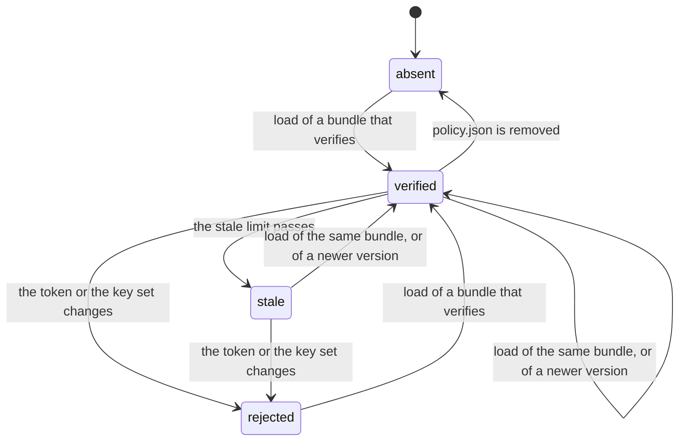

# Local policy gate

The local gate decides actions from the last verified policy on disk. You can load a signed file or run the daemon to sync policy from a team hub. The [trust model](trust-model.md) explains what the gate does not protect against.

`openplexer install` connects a coding agent to the gate, and the hook that it writes runs `openplexer hook`. [Claude Code hooks](hooks-claude-code.md) and [Codex hooks](hooks-codex.md) describe both. `openplexer policy check` asks the gate about one action by hand.

## Connect to a team hub

Install `openplexer` on `PATH`. Get the hub URL, project ID, member ID, bearer token, and trusted public key set from the hub operator. Save the token in a private file. Export `OPENPLEXER_HOME` with a separate directory for each project. Use the same value for setup, the agent that runs the hooks, and the daemon. [Install OpenPlexer](install.md)

```sh
openplexer configure --hub https://hub.example.com --project prj-shop --member mem-ana \
  --keys trusted-jwks.json --token-file member-token
openplexer policy sync
openplexer daemon
```

`policy sync` fetches the first policy immediately. `daemon` syncs on startup and every 15 seconds. It writes received Room events as JSON lines to standard output and connection errors to standard error. Run one daemon per home. The hooks continue to open the verified local policy for each call.

The daemon verifies the bundle against both the advertised JWKS and the operator-provided pin. Replace the pin explicitly with `configure --keys <jwks.json>` after you confirm the new keys with the operator. To renew a member token, run `configure --token-file <file>`. Use the same member ID as the token's owner.

Queue a Room post by passing a hub event request on standard input. See the [hub HTTP API](hub.md#http-api) for the request fields.

```sh
openplexer room post <<'JSON'
{"type":"status","agent":{"id":"session-1","vendor":"codex"},"body":{"summary":"Ready for review"}}
JSON
```

The daemon retries queued posts after disconnect. Room output resumes after the last saved sequence number. A process crash between writing an event to standard output and saving its sequence can replay that event. Consumers that save Room events can use their event IDs to deduplicate them.

## Load a signed file

You need two files from the person who signs the policy of your team: the signed bundle, and the key set that verifies it. The examples under `spec/policy/v1/examples/` are a bundle and a key set that you can try.

1. Build the binary.

	```sh
	make build
	```

2. Store the key set and your member id. The member id is your id in the `members` of the bundle.

	```sh
	bin/openplexer configure --keys spec/policy/v1/examples/jwks/hub-keys.json --member mem-ana
	```

3. Load the signed bundle.

	```sh
	bin/openplexer policy load spec/policy/v1/examples/signed-bundle/message.json
	```

	The command prints the state `verified`, and your role in the policy.

4. Check an action.

	```sh
	bin/openplexer policy check --repo api write src/orders/cart.ts
	```

	The command prints `allow` or `deny`, and the rule that decided.

## Commands

| Command | Action |
|---|---|
| `openplexer configure --keys <jwks.json>` | Stores the key set that verifies a bundle. The file is a JSON Web Key Set, as `spec/policy/v1/jwks.schema.json` defines. |
| `openplexer configure --member <member-id>` | Stores the member id of the developer. |
| `openplexer configure --stale-after-days <days>` | Stores the number of days after which a policy is stale. The default is 14. |
| `openplexer policy load <signed-bundle.json>` | Verifies a signed bundle and makes it the policy in force. The file is a message, as `spec/policy/v1/signed-bundle.schema.json` defines. |
| `openplexer policy sync` | Fetches and verifies the current hub policy once. |
| `openplexer daemon` | Runs policy sync and the Room client in the foreground. |
| `openplexer room post` | Validates and queues one JSON event request from standard input. |
| `openplexer policy status` | Prints the state of the stored policy, the member, and the home directory. |
| `openplexer policy check [--agent <name>] [--session <id>] [--repo <repo>] <action> <target>` | Decides one action and prints the result. The action is `read`, `write`, `exec`, or `git.push`. The target is a path for `read` and `write`, a command for `exec`, and a repo for `git.push`. |

One `configure` command can take several of its options.

| Exit status | Meaning |
|---|---|
| 0 | The command succeeded. For `status`, the policy is verified. For `check`, the action is allowed. |
| 1 | The command failed. For `load`, the bundle is rejected or the file cannot be read, and the policy in force is unchanged. |
| 2 | The command line is not valid. The command prints its usage. |
| 3 | `status` only: the policy is stale. |
| 4 | `status` and `check`: no verified policy is in force. The state is absent or rejected. |
| 5 | `check` only: the action is denied. |

## The home directory

The gate keeps its files in the directory that `OPENPLEXER_HOME` names, or in `.openplexer` in your home directory. The gate creates the directory with access for your user only.

| File | Content | Written by |
|---|---|---|
| `keys.json` | The key set | `configure --keys` |
| `config.json` | Local member and stale settings. A hub configuration also holds its URL, project, and bearer token. Created with mode `0600`. | `configure` |
| `room-cursor.json` | Highest Room sequence received, including skipped event types | `daemon` |
| `room-outbox/` | Filtered posts waiting for acknowledgement, with one idempotency key per file | `room post`, hooks, and `daemon` |
| `room.lock` | Exclusive lock for the daemon that owns the Room cursor | `daemon` |
| `policy.json` | The signed token of the policy in force, and the time `confirmed_at` at which a load last confirmed it | `policy load` and hub sync |
| `audit.jsonl` | The audit log, one record on each line | `policy load` and `policy check` |
| `installs/` | The install journal, one record for each hook file: the agent, the file, the project root of a project-scope install, and what `install` added ([The project root](hooks-claude-code.md#the-project-root)) | `install` and `uninstall` |
| `lock` | An empty file that the commands lock while they write | Every command that writes |

The gate stores the signed token and not the bundle. Each command verifies the token against `keys.json` again before it uses the policy. A token with a bad signature is rejected, and the gate then enforces no policy. A token that the key set verifies is enforced, even when it is an older version than the one `policy load` last stored. `policy load` refuses an older version, but a program that writes a validly signed older bundle straight into `policy.json` rolls the policy back, and the gate reports that bundle as verified. The protection against an agent that writes the file is the hook's denial of writes into the OpenPlexer home, which [issue 15](https://github.com/Multiplexer-si/OpenPlexer/issues/15) added. A program that runs as you can still do it ([what a same-user attacker can still do](trust-model.md#what-a-same-user-attacker-can-still-do-with-the-policy)). If you remove a key from `keys.json`, every bundle that the key signed stops being enforced.

## The states of a policy

| State | Meaning | What the gate does |
|---|---|---|
| `absent` | No policy is stored. | It decides nothing, and reports that no policy is in force. |
| `verified` | The stored token verifies, and a load confirmed it within the stale limit. | It decides each action. |
| `stale` | The stored token verifies, and no load confirmed it within the stale limit. | It decides each action, and reports that the policy is stale. |
| `rejected` | A policy is stored and cannot be used: the token does not verify against the key set, or a file cannot be read. | It decides nothing, and reports the reason. |

The gate stores no state. It computes the state from `policy.json`, `keys.json`, and the clock each time a command runs.



A load that fails changes no state. The policy in force stays as it was.

With no verified policy, the gate does not answer allow or deny. It answers that no policy is in force, and the command that calls the gate chooses what the coding agent may do. The hook denies every call that it judges, with a reason ([the trust model](trust-model.md#decisions-settled-by-install-and-the-hook-command)).

## What a load accepts

`policy load` verifies the bundle under the steps of [the signed bundle](../spec/policy/README.md#the-signed-bundle). While a verified or stale policy is in force, the bundle must also pass these rules.

| Bundle | Result |
|---|---|
| A newer version for the same project | Accepted. It becomes the policy in force. |
| The same version with the same content | Accepted. The load confirms the policy, which makes it fresh. The signature can be a new one. |
| An older version for the same project | Refused by `policy load`. An old policy cannot replace a newer one through a load. |
| The same version with another content | Refused. One version has one content. |
| A bundle for another project | A hub home always refuses it. A file-based home refuses it while a verified policy is in force. |

When the state is absent or rejected, the gate has no version to compare with. A hub home still requires a verified bundle for its configured project with one repository.

## Offline and stale

The gate reads local files. If the source is unavailable, the pinned key check fails, or the hub supplies an older policy while a verified policy is in force, the gate keeps enforcing the stored policy. The daemon retries while it runs.

A bundle carries no issue time and no expiry. So the gate measures the age of a policy on the machine: a policy is stale when no load has confirmed it for `stale_after_days`. A stale policy stays in force. `policy status` reports it with exit status 3, `policy check` prints a notice, and each decision record names the state in `meta.policy_state`. The records of a load do not carry it. A successful load or hub sync confirms the policy and makes it fresh.

`confirmed_at` is a local time and is not signed. A program that runs as you can change it.

## How the gate evaluates an action

The gate passes each action to the [policy evaluator](../spec/policy/README.md#evaluation). The gate sets three inputs itself.

- The member is the member id of `config.json`. If no member is configured, or the bundle does not name the member, the evaluator finds no role, and it denies every action that needs a grant.
- The time is the clock of the machine.
- The overrides are empty. Enforcement requires a signed override contract.

In a hub home, the sole repository ID from the signed bundle selects the read and write rules. In a file-based home, a `read` or a `write` with no `--repo` is evaluated in every repo of the bundle, and one deny decides. If every pattern of the bundle names a listed repo or `*`, a repo that the caller does not know opens no path. A query with no repo never checks a pattern that names a repo the bundle does not list. With `repos: []` and a private area `api:config/**`, `check read config/key.pem` allows, and `check --repo api read config/key.pem` denies.

## The audit log

Each `policy check` appends one record to `audit.jsonl`. Each `policy load` that changes, confirms, or refuses a policy appends one too. A record follows `spec/audit/v1/record.schema.json`, and the records form a [hash chain](../spec/audit/README.md#the-hash-of-a-record).

| `action` | Written when |
|---|---|
| `policy.allowed`, `policy.denied` | The policy decided an action. |
| `policy.unenforced` | An action arrived and no verified policy was in force. |
| `policy.loaded` | A load put a bundle in force. |
| `policy.confirmed` | A load confirmed the bundle in force. |
| `policy.rejected` | A load refused a bundle. |

| Field | Value |
|---|---|
| `workspace_id` | The project id of the policy in force, or an empty string. The log of one machine has no team. |
| `actor_member_id` | The configured member id, or null. |
| `agent_session_id` | The session id that the caller gave, or null. |
| `target` | The path of a `read` or a `write`, the repo of a `git.push`, or the SHA-256 of the command of an `exec`. A command can hold a secret, so the log does not hold its text. For a load, the project id. |
| `reason` | The rule that decided, the reason why no policy is in force, or the reason why a bundle was refused. |
| `meta` | For a decision: `agent`, `action`, `repo`, `area`, `policy_state`, and `policy_version`. For a load: `version`. |

The log is a file that your user can write, so it has the limits that [the trust model](trust-model.md#what-a-verifier-can-prove-from-a-chain-alone) gives for a chain alone. The log stays on the machine. A hub-configured hook queues a separate Room denial with the action, a filtered relative path or omission marker, and a fixed rule.

## Limits

- The gate locks its home directory with `flock`, which exists on Unix only. On another system, `configure`, a load, and an audit record fail, so no policy can be put in force there. `policy check` still prints its result.
- The log grows by one record for each checked action, and nothing removes old records.
- The operator configures the member ID used for policy decisions. The hub assigns the Room author from the bearer token.
